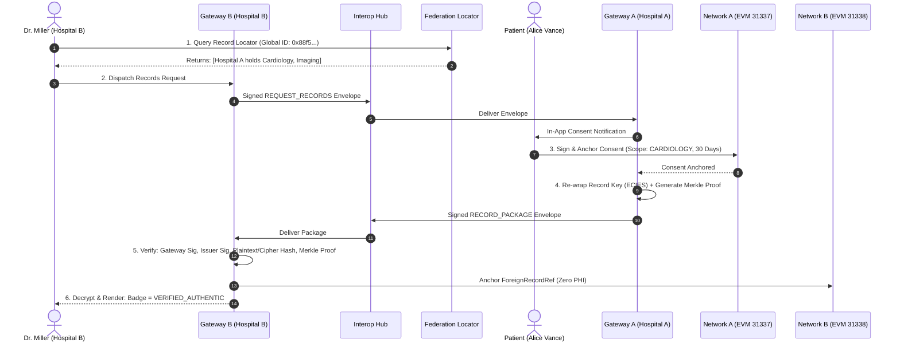
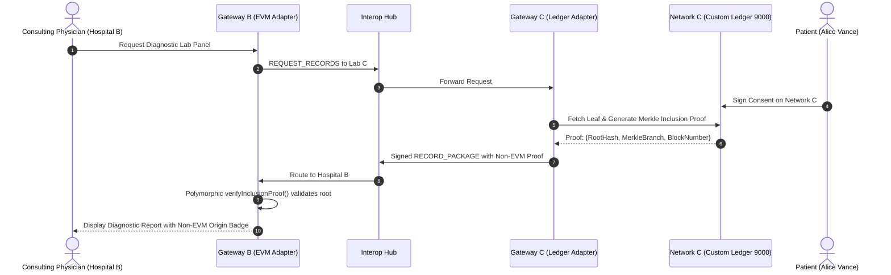
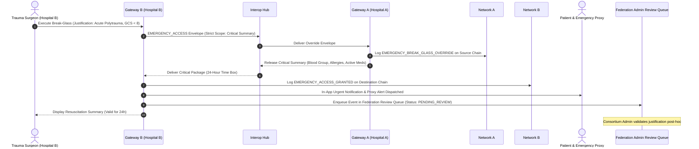
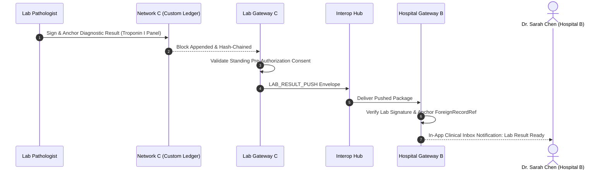
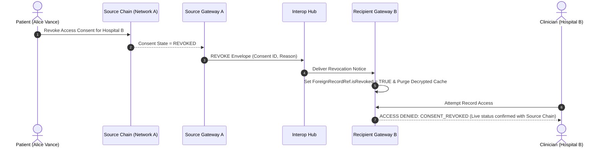

# MediChain: Sovereign Cross-Chain Interoperability Network for Medical Records

> A production-grade, privacy-preserving, cross-chain healthcare data federation allowing autonomous hospitals and diagnostic laboratories running disparate blockchain technologies (EVM and Non-EVM permissioned ledgers) to securely exchange clinical records with patient consent, zero Protected Health Information (PHI) exposure, and verifiable authenticity.

---

## 1. Executive Summary & Problem Statement

Modern healthcare institutions operate sovereign data silos. In contemporary deployments, individual hospitals or hospital networks frequently deploy their own independent blockchains—often built on different ledger architectures (e.g., Ethereum-compatible EVM networks vs. Hyperledger Fabric-style permissioned ledgers). 

Traditional public cross-chain bridges (such as LayerZero, Chainlink CCIP, or Cosmos IBC) either rely on public testnets/mainnets, require costly gas or paid token fees, or are fundamentally incompatible with privacy laws (such as HIPAA and GDPR) because they expose message metadata or lack granular healthcare consent mechanisms.

**MediChain solves this challenge through a sovereign Hub-and-Spoke Interoperability Architecture:**
- **Zero Paid Services & 100% Local**: Fully functional on local networks with zero external APIs, cloud subscriptions, or paid bridges.
- **Sovereign Independence**: Each hospital maintains exclusive administrative and consensus sovereignty over its local blockchain.
- **Heterogeneous Ledger Support**: Uniform polymorphic abstraction over Ethereum EVM nodes and custom non-EVM permissioned append-only ledgers with Merkle tree inclusion proofs.
- **Zero PHI On-Chain**: Neither the sovereign blockchains, the neutral Federation layer, nor the Interop Hub ever see unencrypted patient medical data.
- **Cryptographic Trust & Consent**: Access requires authenticated ECIES per-record key wrapping, dual SHA-256 integrity verification, and patient-signed on-chain consent attestations.

---

## 2. Real-World Clinical Scenarios Supported

1. **Patient Relocation**: A patient moves to a new city. The receiving hospital on Network B queries the neutral Federation Record Locator to identify historical records held at Network A, dispatches a records request via the Interop Hub, receives patient consent on the source chain, and ingests an authenticated, ECIES-wrapped record package with a cryptographic Merkle inclusion proof.
2. **Specialized Care & Lab Referral**: An EVM-based hospital seamlessly requests and ingests diagnostic pathology reports from an independent diagnostics laboratory operating a custom non-EVM permissioned hash-chained ledger.
3. **Emergency Break-Glass Protocol**: In unconscious, life-threatening Level-1 trauma admissions, an attending emergency physician executes a time-boxed (24-hour) break-glass retrieval. Retrieval is strictly restricted to the **Critical Medical Summary** (Blood group, severe allergies, active medications, and recent discharge summary), dual-anchored on both chains, notifies the patient and emergency contacts, and enters the post-hoc **Federation Admin Review Queue**.
4. **Autonomous Standing Consent Lab Push**: A certified diagnostic laboratory pushes signed metabolic panels and bloodwork directly to the ordering hospital's gateway under a standing pre-authorized consent agreement.
5. **Cross-Chain Revocation Propagation**: When a patient revokes consent on the source hospital chain, a signed revocation envelope propagates over the Interop Hub, immediately locking foreign record references and purging local decrypted caches across all recipient hospitals.
6. **Public Mathematical Authenticity Verification**: External verifiers, auditors, or patients can verify any clinical report or diagnostic hash across sovereign networks, inspecting plain-language block anchors and technical Merkle proof branches.

---

## 3. System Architecture & Topology

```
+-------------------------------------------------------------------------------------------------------------+
|                                         FEDERATION TRUST LAYER                                             |
|   Federation Registry Smart Contract (Chain 31340, Port 8547) + Zero-PHI Privacy-Preserving Record Locator   |
+-------------------------------------------------------------------------------------------------------------+
                                                       ^
                                                       | (Attestations & Trust Directory)
                                                       v
+-------------------------------------------------------------------------------------------------------------+
|                                          INTEROP HUB ROUTER                                                 |
|    - Envelope Schema Validation (v1.0.0 FHIR R4)      - Anti-Replay Store (MessageId & Nonce Memory)        |
|    - Exponential Backoff Queue (2s -> 16s)            - Transit Audit Trail (Zero-PHI Attested)             |
+-------------------------------------------------------------------------------------------------------------+
               ^                                       ^                                       ^
               |                                       |                                       |
    (Signed Envelopes)                      (Signed Envelopes)                      (Signed Envelopes)
               v                                       v                                       v
+-------------------------------+       +-------------------------------+       +-------------------------------+
|  Hospital Gateway A (CGH)     |       |  Hospital Gateway B (RSH)     |       |  Diagnostics Gateway C (MDL)  |
|  - ECIES Key Re-wrapping      |       |  - ECIES Key Re-wrapping      |       |  - ECIES Key Re-wrapping      |
|  - Ingestion Proof Verifier   |       |  - Ingestion Proof Verifier   |       |  - Merkle Inclusion Engine    |
|  - ForeignRecordRef Anchor    |       |  - ForeignRecordRef Anchor    |       |  - Authority Validator Signer |
+-------------------------------+       +-------------------------------+       +-------------------------------+
               ^                                       ^                                       ^
               | (ChainAdapter)                        | (ChainAdapter)                        | (ChainAdapter)
               v                                       v                                       v
+-------------------------------+       +-------------------------------+       +-------------------------------+
| NETWORK A: City General       |       | NETWORK B: Regional Specialty |       | NETWORK C: Metro Diagnostics  |
| Architecture: Hardhat EVM     |       | Architecture: Hardhat EVM     |       | Architecture: Non-EVM Ledger  |
| Port: 8545 | Chain ID: 31337  |       | Port: 8546 | Chain ID: 31338  |       | Port: 9000 | Append-Only Block|
| Smart Contracts:              |       | Smart Contracts:              |       | Components:                   |
| - HospitalRegistry.sol        |       | - HospitalRegistry.sol        |       | - SHA-256 Merkle Tree Engine  |
| - RecordRegistry.sol          |       | - RecordRegistry.sol          |       | - Hash-Chained Block Ledger   |
| - ConsentManager.sol          |       | - ConsentManager.sol          |       | - Native HTTP REST / WS API   |
| - AuditLog.sol                |       | - AuditLog.sol                |       | - State Trie & Consent Engine |
+-------------------------------+       +-------------------------------+       +-------------------------------+
```

---

## 4. Cross-Chain Flow Sequence Diagrams

### Scenario 1: Patient Relocation (Network A EVM &rarr; Network B EVM)



### Scenario 2: Specialized Care / Lab Referral (Network C Non-EVM &rarr; Network B EVM)



### Scenario 3: Emergency Break-Glass Flow (Level-1 Trauma)



### Scenario 4: Autonomous Standing Consent Lab Push



### Scenario 5: Real-Time Cross-Chain Revocation Propagation



---

## 5. Security & Threat Model

| Threat / Attack Vector | Mitigation in MediChain | Verification Test |
| :--- | :--- | :--- |
| **Replay Attacks** | Every envelope carries a UUID `messageId` and monotonic `nonce`. The Interop Hub maintains an in-memory & SQLite cache; duplicates are instantly rejected. | `interop/test/security.test.ts` &bull; Test 1 |
| **Rogue / Forged Gateways** | Gateways must be active in the Federation Registry contract. Every envelope digest is verified against the sender's public key registered in the federation. | `interop/test/security.test.ts` &bull; Test 2 |
| **Suspended Institutions** | When an institution's trust status is changed to `SUSPENDED` by the consortium admin, both inbound and outbound envelope transit is blocked. | `interop/test/security.test.ts` &bull; Test 3 |
| **Lapsed / Expired Consent** | `checkConsent` verifies UTC unix timestamps against smart contract state. Stale requests are rejected. | `interop/test/security.test.ts` &bull; Test 4 |
| **Ciphertext Tampering** | Plaintext hash and ciphertext hash are independently notarized. Recipient gateway re-computes `sha256(ciphertext)` and compares against the issuer's signature. | `interop/test/security.test.ts` &bull; Test 5 |
| **Stale Envelope Transit** | Envelopes contain an `expiresAt` header (default 5-minute TTL). Delayed or intercepted messages are discarded. | `interop/test/security.test.ts` &bull; Test 6 |
| **Unlinkable Identity (PII Leaks)**| `globalPatientId` is derived as `sha256(secret || SALT)`. Local pseudonyms are salted per institution, preventing cross-hospital graph linking without wallet signatures. | `interop/test/federation.test.ts` &bull; Test 4 |

---

## 6. Project Structure

```
BE-Project/
├── contracts/                     # Smart Contracts (Hardhat EVM Workspace)
│   ├── contracts/
│   │   ├── HospitalRegistry.sol   # Accredited hospital consortium directory
│   │   ├── RecordRegistry.sol     # Record hashes, doctor ECDSA signatures, versioning
│   │   ├── ConsentManager.sol     # Granular time-boxed access & emergency break-glass
│   │   ├── AuditLog.sol           # Append-only immutable clinical audit trail
│   │   └── FederationRegistry.sol # Neutral cross-chain federation directory & locator
│   └── test/                      # Hardhat automated contract tests (32 tests)
│
├── interop/                       # Cross-Chain Interoperability Engine
│   ├── adapters/
│   │   ├── ChainAdapter.ts        # Polymorphic interface for heterogeneous chains
│   │   ├── EvmAdapter.ts          # Ethers v6 adapter for Networks A, B, and Federation
│   │   └── LedgerAdapter.ts       # Adapter for custom non-EVM permissioned ledger
│   ├── ledger/
│   │   └── CustomLedger.ts        # Non-EVM append-only hash-chained ledger with Merkle root engine
│   ├── federation/
│   │   └── FederationManager.ts   # Federation directory mirror & Record Locator index
│   ├── gateway/
│   │   └── HospitalGateway.ts     # Perimeter security gateway, ECIES re-wrapping & ForeignRecordRef
│   ├── hub/
│   │   └── InteropHub.ts          # Message envelope router, anti-replay memory & retry backoff
│   ├── types/
│   │   ├── envelope.ts            # FHIR-inspired v1.0.0 message envelope schemas & signatures
│   │   └── identity.ts            # Universal pseudonymous patient identity & proof of control
│   ├── flows/
│   │   ├── SharingFlow.ts         # 6-step cross-chain sharing coordinator (Relocation & Referral)
│   │   ├── RevocationAndLabPush.ts# Revocation propagation, lab push & cross-chain verification
│   │   └── EmergencyBreakGlassFlow.ts # Time-boxed Level-1 trauma break-glass & review queue
│   └── test/                      # Automated interop & security tests (55 tests)
│
├── web/                           # Next.js 14 Clinical UI & Web Crypto Layer
│   ├── src/app/
│   │   ├── admin/federation/      # Federation directory & emergency review queue portal
│   │   ├── doctor/records/        # Doctor patient lookup, locator hits & transfer timeline
│   │   ├── doctor/emergency/      # Calm, red-accented break-glass trauma screen
│   │   ├── patient/records/       # "Where my records are" locator index & emergency alerts
│   │   ├── patient/consents/      # Incoming requests approval & 1-click revocation propagation
│   │   └── verify/                # Cross-chain authenticity verifier with network selector
│   ├── src/components/layout/     # AppShell, Sidebar, Header with Sovereign Network Switcher
│   ├── src/context/Web3Context.tsx# Sovereign network state & Web3 authentication
│   └── src/lib/                   # AES-256-GCM, ECIES, SIWE challenge-response, SQLite
│
└── scripts/                       # Orchestration & Seeding Scripts
    ├── dev-all.ts                 # Starts multi-chain network topology
    ├── seed-interop.ts            # Seeds 3 institutions, 3 patients, records & locator
    └── demo-scenarios.ts          # Automated runner for all 6 cross-chain scenarios
```

---

## 7. Quickstart & Execution Guide

### Prerequisites
- **Node.js**: v18.0.0 or higher (v20+ recommended)
- **npm**: v9.0.0 or higher
- Operating System: Windows, macOS, or Linux

### Installation
Clone the repository and install all workspace dependencies:
```bash
git clone https://github.com/your-username/medichain.git
cd BE-Project
npm install
```

### Running All Automated Test Suites
Execute all 115 unit, smart contract, cryptographic, and cross-chain security tests:
```bash
npm run test:all
```

To run individual test workspaces:
```bash
# Run 32 Hardhat EVM smart contract tests:
npm run contracts:test

# Run 28 Web Crypto, SIWE, and AES-GCM tests:
npm run crypto:test

# Run 55 Cross-Chain Interoperability & Security tests:
npm run interop:test

# Run Phase I-8 Security adversarial tests specifically:
npm run test:security
```

### Seeding Test Data
Initialize default sovereign member institutions, fake patients, test clinical records, and the Federation Record Locator index:
```bash
npm run seed:interop
```

### Running Cross-Chain Scenarios Demo
Execute the complete multi-scenario demonstration runner:
```bash
npm run demo:scenarios
```

### Launching the Full System
To start the multi-network environment and web user interface:
```bash
npm run dev:all
```
Open **[http://localhost:3000](http://localhost:3000)** in your browser to access the clinical portal.

---

## 8. Comprehensive Viva Voce Technical Q&A

### Architecture & Interoperability
**Q1: Why did you design a Hub-and-Spoke architecture instead of using public cross-chain bridges like LayerZero, Chainlink CCIP, or Cosmos IBC?**
> *Answer:* Public bridges like LayerZero and CCIP are designed for cryptocurrency token transfers and general messaging on public mainnets. In healthcare:
> 1. Hospitals operate private/consortium networks that cannot rely on public testnets or paid gas tokens.
> 2. Public bridges expose transaction metadata on public explorers, conflicting with HIPAA/GDPR.
> 3. Medical records require specialized healthcare abstractions: patient-controlled consent attestations, FHIR clinical metadata envelopes, ECIES key re-wrapping, and time-boxed emergency break-glass overrides which generic bridge protocols do not provide.

**Q2: How does MediChain achieve interoperability across different blockchain technologies (EVM vs. Non-EVM)?**
> *Answer:* We implement the polymorphic **ChainAdapter Pattern** (`interop/adapters/ChainAdapter.ts`). Both `EvmAdapter` (for Ethereum/Hardhat chains) and `LedgerAdapter` (for the custom permissioned ledger) implement a common TypeScript interface: `registerRecord`, `getRecordProof`, `grantConsent`, `revokeConsent`, `checkConsent`, `logAudit`, and `verifyInclusionProof`. Higher-level gateways and the Interop Hub interact solely with the adapter interface and neutral JSON message envelopes, making the underlying blockchain technology an implementation detail.

**Q3: How does the Non-EVM Custom Ledger simulate enterprise permissioned ledgers like Hyperledger Fabric?**
> *Answer:* `CustomLedger.ts` is an independent Node.js/TypeScript append-only ledger featuring:
> 1. Cryptographic blocks hash-chained to the previous block's SHA-256 header.
> 2. Binary Merkle tree engine calculating Merkle roots for all transactions in each block.
> 3. Native cryptographic inclusion proofs (`getRecordInclusionProof`) generating verification branches.
> 4. Authority validator ECDSA block signatures.
> 5. A native HTTP REST API and WebSocket event emitter (port 9000), simulating non-EVM RPC interfaces.

---

### Security, Cryptography & Privacy
**Q4: How does MediChain ensure Zero Protected Health Information (PHI) on the blockchain and in the Interop Hub?**
> *Answer:* Medical documents are encrypted off-chain on the client side using Web Crypto AES-256-GCM with a unique per-record 256-bit symmetric key. Only two 32-byte cryptographic digests are anchored on-chain: `recordHash` (`sha256(plaintext)`) and `cipherHash` (`sha256(ciphertext)`). The Interop Hub only routes signed metadata envelopes carrying encrypted blobs and recipient-wrapped keys; it never receives plaintext clinical data or decryption keys.

**Q5: What is the purpose of ECIES key re-wrapping during cross-chain transfer?**
> *Answer:* When Hospital A transfers a record to Hospital B, Hospital A must not share its own private key. Instead, Hospital A decrypts the per-record AES key locally, re-encrypts (wraps) that AES key using Hospital B's gateway public key via ECIES (`secp256k1`), and includes the wrapped key in the record package envelope. Only Hospital B's private gateway key can unwrap the AES key to decrypt the payload.

**Q6: How does the system defend against Replay Attacks?**
> *Answer:* Every cross-chain message envelope contains a cryptographically random UUID (`messageId`), a monotonic sender `nonce`, an `issuedAt` timestamp, and a strict `expiresAt` TTL (default 300 seconds). The Interop Hub checks both an in-memory `Set` and an SQLite anti-replay store before processing. If an envelope has an expired timestamp, a seen `messageId`, or a duplicate nonce, it is immediately rejected with `REPLAY_ATTACK_DETECTED`.

**Q7: How is patient identity handled without leaking PII across hospitals?**
> *Answer:* MediChain uses a **Universal Pseudonymous Identity** scheme. A global identifier is computed as `globalPatientId = sha256(identitySecret || CONSORTIUM_SALT)`. To prevent cross-institution profiling, each hospital derives an institution-specific local pseudonym: `localPseudonym = sha256(globalPatientId || institutionId)`. When authorizing transfers, the patient signs an on-chain challenge using their private wallet key (`createProofOfControl`).

---

### Clinical Governance & Emergency Access
**Q8: What prevents abuse of the Emergency Break-Glass feature?**
> *Answer:* Emergency break-glass access enforces multiple cryptographic and institutional safeguards:
> 1. **Strictly Scoped Data**: Attending doctors receive access *only* to the **Critical Medical Summary** (`BLOOD_GROUP`, `ALLERGIES`, `ACTIVE_MEDICATIONS`, `RECENT_DISCHARGE_SUMMARY`), preventing bulk history dumps.
> 2. **Strict Time Box**: Smart contract logic enforces a 24-hour expiration window.
> 3. **Dual-Chain Audit**: The request is permanently logged on the destination chain, and the access grant is logged on the source chain.
> 4. **Patient Alerts**: Notifications are immediately sent to the patient's in-app portal and designated emergency contact phone numbers.
> 5. **Federation Admin Review Queue**: Every break-glass event is enqueued for mandatory post-hoc peer review by consortium compliance officers (`JUSTIFICATION_VALIDATED` vs. `FLAGGED_FOR_INQUIRY`).

**Q9: How does real-time revocation propagation work across chains?**
> *Answer:* When a patient revokes consent on their home hospital's chain (Network A), Gateway A notarizes the revocation on-chain and dispatches a signed `REVOKE` envelope via the Interop Hub to Gateway B. Gateway B marks its local `ForeignRecordReference.isRevoked = true` and purges any decrypted cache. Furthermore, whenever a doctor attempts to view a foreign record, Gateway B re-verifies consent status in real time against Network A's adapter.

**Q10: What is the Federation Record Locator and why is it privacy-preserving?**
> *Answer:* The Federation Record Locator (`FederationRegistry.sol` on Federation Chain 31340) maps `globalPatientId` to a list of `{institutionId, chainType, recordType, recordCount, lastUpdated}`. It answers "which hospitals hold records for this patient?" without revealing diagnoses, test results, doctor names, or medical details. Patients can also toggle an opt-out flag to hide their locator entries from federated discovery.

---

## 9. License

This project is licensed under the **MIT License**. Free and open source for academic, research, and non-commercial institutional healthcare deployments.
