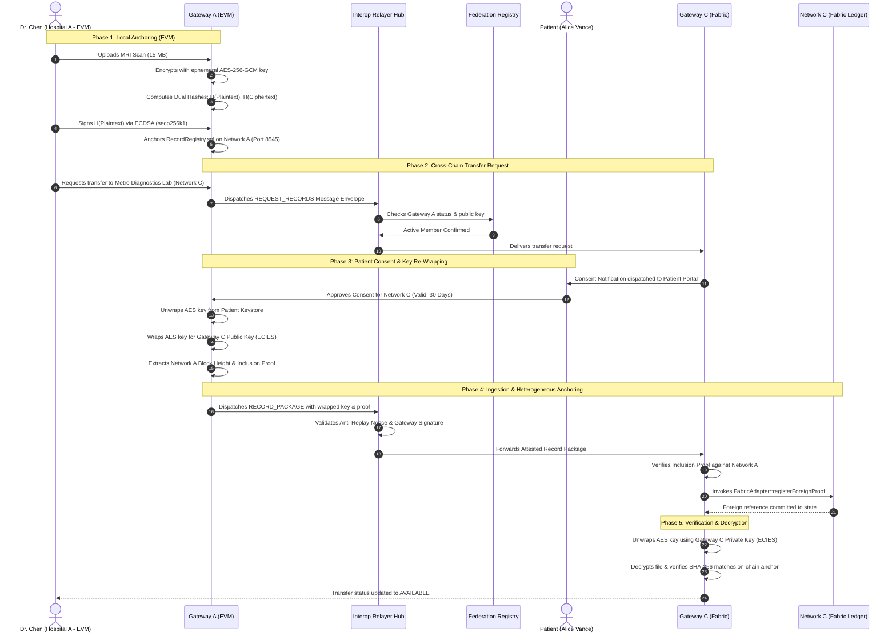

# MediChain: Heterogeneous Cross-Chain Interoperability Explained

This document details how healthcare institutions running incompatible distributed ledger technologies—specifically **Ethereum-compatible EVM chains** and **Hyperledger Fabric permissioned networks**—exchange clinical data securely without centralizing health records or compromising patient privacy.

---

## 1. The Interoperability Challenge in Healthcare

Hospitals rarely run the same enterprise infrastructure. In modern consortium deployments:
- **Major Hospitals (e.g. City General, Regional Specialty)** frequently deploy EVM-compatible ledgers (Hardhat, Anvil, Hyperledger Besu) due to rich smart contract ecosystems and physician wallet compatibility (MetaMask).
- **Certified Diagnostic Laboratories (e.g. Metro Diagnostics Lab)** deploy Hyperledger Fabric due to high transaction throughput, lack of gas tokens, and privacy-preserving channel architectures.

Traditional cross-chain bridges (LayerZero, Wormhole, Chainlink CCIP) are designed for token bridging between public networks. They are **unsuitable for healthcare** because:
1. They require public internet visibility, violating HIPAA/GDPR clinical data privacy boundaries.
2. They incur external gas or relayer token fees.
3. They lack healthcare-specific primitives (patient consent expiry, medical emergency break-glass, ECIES key re-wrapping).

---

## 2. MediChain Solution: Hub-and-Spoke Attestation & Polymorphic Adapters

MediChain bridges disparate blockchains through a **Federation Trust Layer** combined with **Polymorphic Chain Adapters**:

```
+---------------------------------------------------------------------------------------------------------+
|                                      FEDERATION REGISTRY (PORT 8547)                                    |
|                   - Canonical Directory of Accredited Institutions & Public Keys                        |
|                   - Zero-PHI Record Locator Index: H(PID) -> [Network A, Network C]                     |
+---------------------------------------------------------------------------------------------------------+
                                                     ▲
                                                     │ (Attestation Verification)
                                                     ▼
+---------------------------------------------------------------------------------------------------------+
|                                           INTEROP RELAYER HUB                                           |
|       - Validates Sender Signature     - Checks Anti-Replay Nonce     - Enqueues with Exponential Jitter|
+---------------------------------------------------------------------------------------------------------+
                    ▲                                                                 ▲
                    │ (Signed Envelope)                                               │ (Signed Envelope)
                    ▼                                                                 ▼
     +------------------------------+                                  +------------------------------+
     |   HOSPITAL GATEWAY A (EVM)   |                                  |   HOSPITAL GATEWAY C (FABRIC)|
     +------------------------------+                                  +------------------------------+
                    │                                                                 │
                    ▼                                                                 ▼
     +------------------------------+                                  +------------------------------+
     |   EvmAdapter (JSON-RPC)      |                                  |   FabricAdapter (gRPC)       |
     +------------------------------+                                  +------------------------------+
                    │                                                                 │
                    ▼                                                                 ▼
+---------------------------------------+                          +---------------------------------------+
| NETWORK A: City General Hospital      |                          | NETWORK C: Metro Diagnostics Lab      |
| Architecture: EVM (Solidity Contracts)|                          | Architecture: Hyperledger Fabric / Sim|
| Port: 8545 | Chain ID: 31337          |                          | Port: 9000 | State Trie / Blocks     |
+---------------------------------------+                          +---------------------------------------+
```

---

## 3. Step-by-Step Cross-Chain Transfer Sequence

The following Mermaid sequence diagram traces a specialized referral: City General Hospital (EVM) shares a patient's diagnostic imaging with Metro Diagnostics Lab (Hyperledger Fabric):



---

## 4. Trust Model & Security Invariants

MediChain enforces a **Zero-Trust Consortium Security Model**:

1. **Non-Collusion Guarantee:** Even if Network A and Network B share an untrusted relayer, the relayer sees only encrypted bytes (`storage/*.enc`) and signed metadata envelopes. The relayer cannot decrypt records because symmetric keys are wrapped via ECIES directly between the patient and the authorized recipient hospital.
2. **Independent Non-Repudiation:** The attending physician digitally signs the plaintext hash using their private key. Even if hospital administrators corrupt database entries, the doctor's cryptographic signature cannot be forged.
3. **Inclusion Verification:** When a recipient gateway receives an attested record from another chain, it verifies the source chain's block height and transaction receipt before accepting the foreign reference.
4. **Instant Revocation Propagation:** When a patient revokes access on-chain, a signed `REVOCATION_PROPAGATION` message envelope is broadcast through the Hub. The recipient gateway immediately locks the local foreign reference and purges any decrypted memory buffers.

---

## 5. Architectural Limitations & Roadmap

| Feature | Current Implementation (Academic & Evaluation) | Production Roadmap / Future Work |
| :--- | :--- | :--- |
| **Relayer Topology** | Single autonomous Relayer Hub with anti-replay memory. | **Decentralized Relayer Committee:** Multi-party computation (MPC) or $M\text{-of-}N$ threshold signature scheme (TSS). |
| **Light Client Verification**| Ingestion verifies block height, transaction ID, and attestation signatures. | **On-Chain Light Clients (SPV):** Merkle Patricia trie verification on-chain, eliminating relayer trust entirely. |
| **Consent Privacy** | Consent evaluated on-chain via `ConsentManager.sol` using salted pseudonyms. | **Zero-Knowledge Consent Proofs (zk-SNARKs):** Evaluates patient consent without revealing which doctor or hospital was granted access. |
| **Non-EVM Adapter** | Dual-mode: Real Hyperledger Fabric chaincode + Zero-dependency simulated ledger for Windows hosts. | **Direct Fabric CA Integration:** Automated X.509 certificate issuance via Fabric Membership Service Providers (MSP). |
