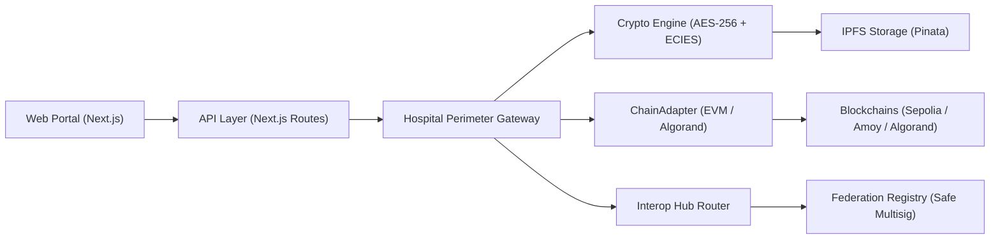
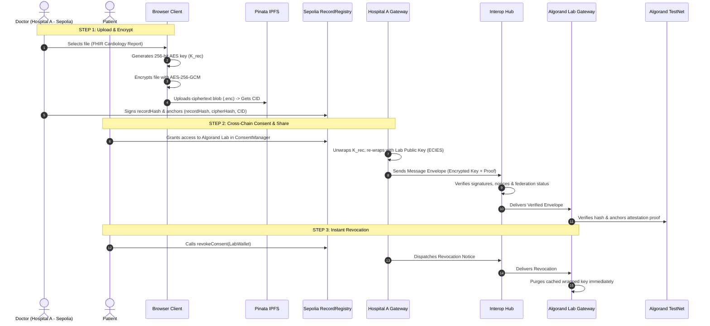

# MediChain — Simple Explanation & Architecture Guide

> **Audience:** Students, Evaluators, and Engineers  
> **Rule:** Plain English first. Every technical term has a one-line plain explanation.

---

## 1. What Did We Build, and What Problem Does It Solve?

Hospitals currently store patient records in private software silos that cannot safely communicate with each other. When you move to a new city or visit a lab, doctors either cannot see your history or fax paper records, risking medical errors. Storing health data on a public blockchain is illegal because blockchains are permanent and transparent, violating medical privacy laws (HIPAA/GDPR).

**What We Built:**  
**MediChain** is a sovereign cross-chain healthcare network. It allows independent hospitals and diagnostic labs—each running their own blockchain—to share medical records securely in seconds. The patient retains 100% consent control, and zero patient names or medical files are ever exposed on any public blockchain.

---

## 2. Users, Institutions & Blockchain Networks

### The Consortium Network Layout
Each healthcare institution maintains its own autonomous blockchain:

| Institution | Role | Blockchain Network | Technology |
|---|---|---|---|
| **Hospital 1 (City General)** | Primary Care & Federation Hub | **Ethereum Sepolia** (Chain ID: 11155111) | EVM / Solidity |
| **Hospital 2 (Regional Specialty)** | Specialist Referrals & Surgery | **Polygon Amoy** (Chain ID: 80002) | EVM / Solidity |
| **Diagnostic Lab (Metro Lab)** | Blood Tests & Pathology | **Algorand TestNet** (Chain ID: 416002) | AVM / TEAL (Non-EVM) |
| **Consortium Governance** | Neutral Administration & Oversight | **Ethereum Sepolia** | Gnosis Safe 2-of-3 Multi-Sig |

### How Users Are Created and Managed
- **Patients:** Register in-person at an authorized hospital (`web/src/app/api/patients/register/route.ts`). Their national ID or passport is salted and hashed into a random 32-byte **Global Patient ID** (`interop/types/identity.ts`). An in-browser keystore is generated, and a local pseudonym is created for each hospital so two hospitals cannot correlate the same patient.
- **Doctors / Clinical Staff:** Registered by their hospital admin in `StaffRegistry.sol` (`contracts/contracts/StaffRegistry.sol`). Each doctor is assigned a role (`ATTENDING_PHYSICIAN`, `SURGEON`, `RADIOLOGIST`). If a doctor leaves, the admin revokes their key on-chain in 1 transaction, cutting off access immediately.
- **Hospital Admins:** Control local staff registration and manage gateway parameters.
- **Federation Admins:** A 3-member consortium committee that governs the network using a Gnosis Safe 2-of-3 multi-sig wallet on Sepolia (`contracts/contracts/FederationRegistry.sol`). Two out of three admins must sign before a new hospital can join or be suspended.

### How Different Networks Share Records
Because Ethereum, Polygon, and Algorand speak completely different languages, they do not communicate directly. Instead, each hospital runs an off-chain **Perimeter Gateway** (`interop/gateway/HospitalGateway.ts`). Gateways exchange cryptographically signed, timestamped **Message Envelopes** through a neutral, zero-knowledge **Interop Hub** (`interop/hub/InteropHub.ts`).

---

## 3. Tools & Accounts: What Each One Does and Controls

| Tool / Account | Purpose in Project | What It Holds / Controls |
|---|---|---|
| **MetaMask (Deployer Wallet)** | Used in development to publish smart contracts to testnets. | Holds Sepolia ETH and Polygon POL testnet gas coins to pay contract deployment fees. |
| **Relayer Wallet** | Automated gateway backend wallet (`scripts/fund-check.ts`). | Holds small gas balances to sponsor gasless patient transactions (`MinimalForwarder.sol`) and attest cross-chain proofs. |
| **Safe Signers (2-of-3)** | 3 separate consortium admin addresses. | Holds governance power over `FederationRegistry.sol`. No single admin can approve or remove a hospital alone. |
| **Alchemy** | Cloud node provider (RPC endpoint). | Provides HTTP/WebSocket endpoints translating web requests into blockchain calls on Sepolia and Amoy. |
| **Neon** | Serverless PostgreSQL cloud database (`prisma/schema.prisma`). | Stores structured off-chain indexes and gateway metadata with zero plaintext clinical data. |
| **Pinata** | Cloud IPFS (InterPlanetary File System) pinning service. | Holds AES-256 encrypted ciphertext files (`.enc`). Pinata cannot read them because it never has the decryption keys. |
| **Algorand Wallet** | 25-word mnemonic account for the Diagnostic Lab (`scripts/deploy-algorand.ts`). | Holds testnet ALGOs to fund and call TEAL smart contracts on Algorand TestNet. |
| **Gnosis Safe** | Smart contract multisig vault on Sepolia (`sep:0x288400fD69d9463D394da8a437D4bd79D31f8158`). | Owns the `FederationRegistry` contract and enforces committee voting rules. |
| **GitHub & Vercel** | Git repository and cloud hosting. | GitHub stores source code; Vercel builds and hosts the Next.js web application (`medichain-web`). |

---

## 4. Database: Storage, Views & Exclusions

- **Where It Is Hosted:** Dual-mode design (`web/src/lib/db/service.ts`). When offline or running tests, it uses a local SQLite database (`storage/medichain.db`). In production, it connects to a serverless Neon PostgreSQL cluster via Prisma (`prisma/schema.prisma`).
- **How to Open and View It:**
  1. **Prisma Studio:** Run `npx prisma studio` to open a visual database editor in your browser.
  2. **Neon Web Console:** Log into `console.neon.tech` and query tables using the SQL editor.
  3. **In-App Inspector:** Open the **Zero-PHI Storage Inspector** page directly inside the app at `/admin/inspector`.
- **What It Stores:**
  - `records`: Metadata index (record ID, patient pseudonym hash, cipher hash, IPFS CID, MIME type, version number).
  - `wrapped_keys`: ECIES-encrypted AES keys, wrapped separately for authorized recipient hospital wallets.
  - `institutions`: Registry of member institutions, chain IDs, gateway public keys, and status (`ACTIVE`, `SUSPENDED`).
  - `staff_members`: Physician names, hospital wallet, role, and active status.
  - `access_requests`: Patient consent records and cross-chain transfer audit trails.
  - `emergency_access_events`: 24-hour break-glass emergency trauma access logs and justification notes.
- **What Is Deliberately NOT Stored:**
  - ❌ No medical record plaintext (no diagnosis text, no lab results, no doctor notes).
  - ❌ No patient legal names or national identity numbers (SSN/Passport).
  - ❌ No private keys or unencrypted symmetric AES keys.

---

## 5. What Stays Where? (Data Partitioning)

```
[ Browser / Client ]              [ Cloud IPFS (Pinata) ]            [ Blockchains (Sepolia/Amoy/Algo) ]
-------------------               -----------------------            ----------------------------------
• Plaintext clinical file         • AES-256 Encrypted Ciphertext     • Cryptographic Hash (SHA-256)
• AES-256 symmetric key             Payloads (.enc files)            • Ciphertext Hash
• In-memory keystore password     • Random noise to anyone without   • Doctor ECDSA digital signature
• Decrypted view (RAM only)         the private key                  • Patient Consent boolean (0 or 1)
                                                                     • Inclusion Proofs & Timestamps
                                                                     • ZERO clinical text or PHI
```

---

## 6. Folder Structure & Key Files

### Top-Level Folder Tree
```text
BE-Project/
├── contracts/             # Solidity smart contracts & Hardhat test suite
│   ├── contracts/         # FederationRegistry, RecordRegistry, ConsentManager, StaffRegistry, Forwarder
│   └── test/              # EVM contract unit tests (37 passing tests)
├── interop/               # Cross-chain engine & multi-chain adapters
│   ├── adapters/          # Unified ChainAdapter (EvmAdapter & AlgorandAdapter)
│   ├── algorand/          # Algorand TEAL smart contracts (Record anchor contract)
│   ├── gateway/           # Hospital Perimeter Gateways (HospitalGateway.ts)
│   ├── hub/               # Zero-Knowledge Interop Hub router (InteropHub.ts)
│   ├── federation/        # Federation membership & cache manager
│   ├── types/             # FHIR canonical schema, Envelope format, Identity derivation
│   └── test/              # Cross-chain integration & adversarial security tests (68 passing)
├── web/                   # Next.js 14 Full-Stack Web Application
│   ├── src/app/           # User portals: /patient, /doctor, /admin, /verify, /explorer
│   ├── src/app/api/       # REST API endpoints (auth, records, federation, locator, emergency)
│   ├── src/lib/crypto/    # Client-side AES-256-GCM encryption & ECIES key wrapping
│   ├── src/lib/ipfs/      # Pinata IPFS service with local cache fallback
│   ├── src/lib/db/        # SQLite / Neon dual-mode database manager
│   └── src/context/       # Web3Context with MetaMask & demo role switching
├── prisma/                # Prisma ORM schema & migrations for Neon PostgreSQL
├── storage/               # Encrypted off-chain payloads (.enc) and SQLite database cache
├── scripts/               # Automation: status.ts, fund-check.ts, demo-scenarios.ts, propose-multisig.ts
└── docs/                  # Architecture guides and reference documentation
```

### The 5 Most Important Files to Open First
1. [`interop/adapters/ChainAdapter.ts`](file:///c:/Users/Baskar/Desktop/BE-Project/interop/adapters/ChainAdapter.ts): The unified interface making EVM and Algorand look identical to application code.
2. [`interop/hub/InteropHub.ts`](file:///c:/Users/Baskar/Desktop/BE-Project/interop/hub/InteropHub.ts): The cross-chain postal service that validates signatures, nonces, and anti-replay rules.
3. [`web/src/lib/crypto/service.ts`](file:///c:/Users/Baskar/Desktop/BE-Project/web/src/lib/crypto/service.ts): The client-side cryptography engine that encrypts records and wraps keys.
4. [`contracts/contracts/FederationRegistry.sol`](file:///c:/Users/Baskar/Desktop/BE-Project/contracts/contracts/FederationRegistry.sol): The multi-chain consortium directory governed by the Safe 2-of-3 multisig.
5. [`scripts/demo-scenarios.ts`](file:///c:/Users/Baskar/Desktop/BE-Project/scripts/demo-scenarios.ts): Runs all 6 real clinical journeys end-to-end with zero mock shortcuts.

### The Role of the `.env` File
The `.env` file holds secrets and endpoints: `DEPLOYER_PRIVATE_KEY` (contract deployment), `RELAYER_PRIVATE_KEY` (sponsored gas), `SEPOLIA_RPC_URL` & `AMOY_RPC_URL` (Alchemy nodes), `ALGORAND_DEPLOYER_MNEMONIC` (Algorand wallet), `SEPOLIA_SAFE_MULTISIG_ADDRESS`, `PINATA_JWT`, and `DATABASE_URL` (Neon PostgreSQL). Values are never committed to version control.

---

## 7. How the Components Work Together



- **Contracts:** Enforce mathematical rules on-chain (consent, hashes, doctor roles, multisig).
- **Adapters:** Hide blockchain differences so code doesn't care whether it talks to Ethereum or Algorand.
- **Gateways:** Act as security firewalls for each hospital; encrypts files and signs envelopes.
- **Interop Hub:** Routes messages between hospitals, verifies digital signatures, and drops malicious requests.
- **Federation Registry:** Maintains the roster of valid hospitals and their active gateway keys.
- **Web App:** Gives doctors, patients, and administrators clean visual interfaces.

---

## 8. Complete Working Flow in Numbered Steps

### Scenario: Doctor at Hospital A Uploads Record, Shares with Algorand Lab, Then Patient Revokes



1. **Upload & Client-Side Encryption:**
   - In Hospital A's browser, the doctor selects a clinical file.
   - The browser generates a random 32-byte AES-256 key (`K_rec`) and encrypts the file using AES-256-GCM.
   - The browser uploads the encrypted `.enc` file to Pinata IPFS, returning an IPFS CID (`bafkrei...`).
   - The doctor signs the document's SHA-256 hash with their private key.
   - The gateway anchors `(recordHash, cipherHash, ipfsCID, doctorSignature)` to Sepolia `RecordRegistry.sol`.
2. **Cross-Chain Sharing to Algorand Lab:**
   - Patient grants consent to the Algorand Lab on Sepolia `ConsentManager.sol`.
   - Hospital A's Gateway retrieves `K_rec`, wraps it using the Algorand Lab's secp256k1 public key via ECIES, and builds a standard signed Message Envelope (`interop/types/envelope.ts`).
   - Hospital A dispatches the envelope through the Interop Hub (`interop/hub/InteropHub.ts`).
   - The Interop Hub checks Hospital A's status in `FederationRegistry`, verifies the signature, and delivers the envelope to the Algorand Lab Gateway.
   - The Algorand Lab Gateway fetches the encrypted file from IPFS, verifies that `sha256(file) == cipherHash`, and anchors the cross-chain attestation to the Algorand TestNet TEAL application.
3. **Instant Revocation:**
   - Patient calls `revokeConsent()` on Sepolia `ConsentManager.sol`.
   - Hospital A broadcasts a cross-chain revocation envelope through the Interop Hub.
   - The Algorand Lab Gateway invalidates the wrapped key and purges its local cache. Any future read request is immediately blocked.

---

## 9. Security Matrix: Threats, Controls, and Code Locations

| Threat | How It Is Prevented / Detected | Location in Code |
|---|---|---|
| **Database Compromise / Stolen Files** | All off-chain files are encrypted with AES-256-GCM; record keys are wrapped using multi-recipient ECIES. Without the recipient's private key, ciphertext is mathematically unreadable. | [`web/src/lib/crypto/service.ts`](file:///c:/Users/Baskar/Desktop/BE-Project/web/src/lib/crypto/service.ts#L45-L85) |
| **Tampered Medical File (Malicious Alteration)** | The system computes `sha256(decryptedFile)` and compares it against the immutable `recordHash` anchored on-chain. If even 1 bit differs, decryption rejects with an integrity violation. | [`web/src/app/api/records/verify/route.ts`](file:///c:/Users/Baskar/Desktop/BE-Project/web/src/app/api/records/verify/route.ts#L60-L95) |
| **Replay Attack (Re-sending an Old Message)** | Every message envelope requires a unique UUID `messageId`, an incrementing monotonic `nonce`, and a 5-minute `expiresAt` timestamp. Duplicates are rejected. | [`interop/hub/InteropHub.ts`](file:///c:/Users/Baskar/Desktop/BE-Project/interop/hub/InteropHub.ts#L70-L115) |
| **Rogue / Imposter Hospital Gateway** | The Interop Hub cryptographically recovers the signer's public key from the envelope's ECDSA signature and checks if it matches an `ACTIVE` member in `FederationRegistry`. | [`interop/gateway/HospitalGateway.ts`](file:///c:/Users/Baskar/Desktop/BE-Project/interop/gateway/HospitalGateway.ts#L110-L150) |
| **Disgruntled / Unauthorized Doctor Access** | Hospital admins register doctors on-chain with granular roles. Calling `revokeStaff()` immediately disables access; every access check evaluates role validity in real time. | [`contracts/contracts/StaffRegistry.sol`](file:///c:/Users/Baskar/Desktop/BE-Project/contracts/contracts/StaffRegistry.sol#L45-L80) |
| **Patient Identity Tracking Across Hospitals** | The patient's national ID is salted with an HMAC secret to produce a Global Patient ID (`GPI`). Local pseudonyms are generated by hashing `GPI + HospitalID`, making them unlinkable across hospitals. | [`interop/types/identity.ts`](file:///c:/Users/Baskar/Desktop/BE-Project/interop/types/identity.ts#L25-L65) |

---

## 10. Free-Tier Deployment Blueprint

Everything in this architecture runs on free, open-source services:

| Component | Free Platform | Free Tier Limits |
|---|---|---|
| **Web Application & APIs** | **Vercel** (Hobby) | Free forever, 100 GB bandwidth/month, serverless functions. |
| **Database** | **Neon.tech** (PostgreSQL) | Free 0.5 GB storage, serverless compute, branching support. |
| **Off-Chain File Storage** | **Pinata** (IPFS) | Free 1 GB storage, up to 500 files, free dedicated gateway. |
| **Ethereum Hospital (Network A)** | **Ethereum Sepolia** | Public testnet, free testnet ETH via Google Cloud Web3 / Alchemy faucets. |
| **Polygon Hospital (Network B)** | **Polygon Amoy** | Public testnet, free POL testnet tokens via Polygon faucet. |
| **Diagnostic Lab (Network C)** | **Algorand TestNet** | Public testnet, free ALGO testnet tokens via AlgoNode Dispenser. |
| **Multi-Sig Governance** | **Gnosis Safe** | Deployed on Sepolia, zero maintenance cost, managed via `app.safe.global`. |

---

## 11. Honest Gaps & Current Limitations

To maintain academic and professional transparency with recruiters and evaluators:

1. **Public Testnets vs. Mainnet:** The project runs on public testnets (Sepolia, Amoy, Algorand TestNet). The cryptography and contracts are production-standard, but no real money is used for gas fees.
2. **Interop Hub Routing:** The Interop Hub is implemented as an off-chain relay service in TypeScript (`interop/hub/InteropHub.ts`). In an enterprise deployment, this would be decentralized via decentralized oracle networks like Chainlink CCIP or LayerZero.
3. **IPFS Gateway Propagation Lag:** Public IPFS gateways sometimes take 10 to 30 seconds to propagate pinned files across DHT nodes. To prevent UI timeouts during evaluations, `IpfsService` maintains an automated local read-through cache (`storage/<cid>.enc`) so local retrievals are instantaneous while the file pins to Pinata in the background.
4. **Browser Wallet Demo Mode:** While the application fully supports MetaMask for EIP-4361 Sign-In with Ethereum, it includes deterministic built-in demo keys. This allows evaluators to switch between Doctor, Patient, and Admin roles without installing MetaMask.
5. **Algorand Contract Deployment:** Algorand smart contracts use real TEAL bytecode deployed via AlgoNode API (`scripts/deploy-algorand.ts`). Full Hyperledger Fabric chaincode is available in `/fabric`, while the runtime uses `AlgorandAdapter` to avoid requiring Docker on the evaluator's laptop.
